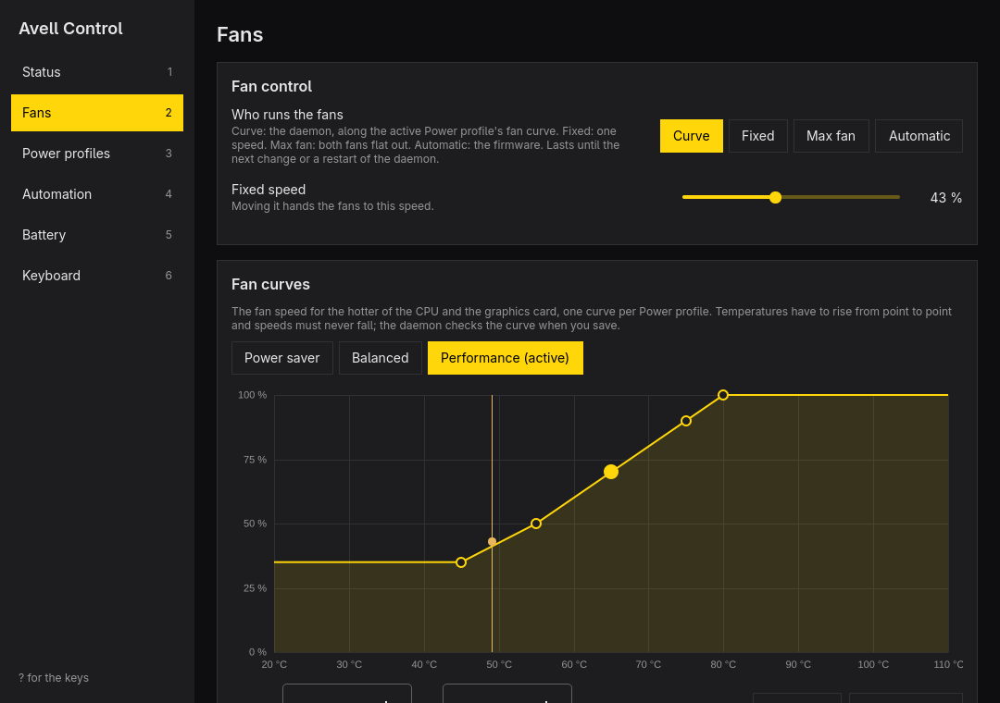

# app



**Avell Control** (`avell-control`): the windowed control centre for the Avell A52 MOB. C++ and Qt Quick, built the way
Omarchy's own apps are (qmake6 and make into one binary, the Omarchy theme followed live, installed as an Arch package so
it shows in the app launcher).

It is a thin client of the daemon's control API (`org.avell.Control1` on the system bus, see `../daemon/README.md`) and
holds no rules of its own: it reads `GetStatus` and `GetConfigJson` every 2 s, sends every change to the daemon, and
shows what the daemon answered. A configuration the daemon refuses is not saved; its reason is shown and the edit stays.
While `avelld` is stopped the window says so and is disabled; it comes back by itself when the daemon does.

## Pages

| Key | Page | What |
|---|---|---|
| `1` | Status | The machine's state, as `avellctl status` prints it |
| `2` | Fans | Who runs the fans now (curve, fixed, Max fan, automatic); each Power profile's fan curve as a chart; the start mode and the hysteresis |
| `3` | Power profiles | The active Power profile; each profile's bundle: TGP offset, Dynamic Boost, CPU power limits |
| `4` | Automation | The charger rules and game detection |
| `5` | Battery | Battery care: the charging profile and the charge cap |
| `6` | Keyboard | The keyboard backlight: brightness and colour |

Two kinds of change:

- **The configuration** (fan curves, hysteresis, start mode, bundles, charger rules, game detection) is edited as a draft.
  A bar at the bottom offers Save and Revert; Save sends the whole configuration with `SetConfigJson`. While there are no
  unsaved edits the pages follow the daemon's configuration, so changes from `avellctl config set` show up within 2 s.
- **Everything else** (the active Power profile, who runs the fans, battery care, the keyboard backlight) applies at once.

A feature the driver does not expose on this machine (the status lists it under `unavailable`) keeps its control, disabled,
with a note saying so.

## Fan-curve editor

Temperature across (20 to 110 °C), fan speed up. Drag a point to move it, double-click the chart to add one, right-click a
point to remove it; a selected point can also be typed in or moved with the arrow keys. The yellow line and dot are the
temperature now and the speed the daemon is asking for, on the active Power profile's curve. The editor lets a point go
anywhere: whether the curve is valid is the daemon's call, on Save.

## Keys

| Key | What |
|---|---|
| `1` to `6` | Go to a page |
| `Ctrl+S` | Save the configuration |
| `Ctrl+R` | Revert the unsaved changes |
| Arrows | Move the selected point of a fan curve |
| `Delete` | Remove the selected point |
| `?` | Show or hide the list of keys |
| `Q` | Quit (asks first when there are unsaved changes) |

## Build, test, install

Needs `qt6-base`, `qt6-declarative`, `qt6-svg`, `qt6-wayland`, `gcc` and `make` (all part of Omarchy).

```bash
bin/build      # qmake6 + make into build/avell-control
bin/test       # the Qt Test binary, offscreen
bin/install    # builds the package (pkgbuild/PKGBUILD) and installs it: makepkg -fsi
```

`bin/install` passes its arguments to makepkg (`bin/install --noconfirm`). The package installs `/usr/bin/avell-control`,
the launcher entry (`avell-control.desktop`) and the icon; remove it with `sudo pacman -R avell-control`. Build output goes
to `build/` and `pkgbuild/pkg/`, both ignored by git.

## Layout

| Path | What |
|---|---|
| `src/backend.{h,cpp}` | The one D-Bus client, exposed to QML as `backend`: `running`, `status`, `config`, `lastError`, and the setters |
| `src/theme.{h,cpp}` | The Omarchy theme, followed live: the colours of the current `colors.toml` and Hyprland's rounding |
| `src/translator.{h,cpp}` | Follows the Omarchy language; catalogs go in `src/i18n/<code>.json` (only English so far) |
| `src/Main.qml` | The window: the page list, the configuration draft, the Save bar, the keys |
| `src/*Page.qml`, `src/CurveEditor.qml` | The pages and the fan-curve chart |
| `tests/` | The backend against a stand-in daemon on the session bus; the theme and the translator against temp directories |
| `pkgbuild/` | The package, the launcher entry and the icon |

The tests never touch the real daemon. To look at the real window without a display, load `qrc:/Main.qml` with
`QT_QPA_PLATFORM=offscreen QT_QUICK_BACKEND=software` and grab the window.

`LICENSE` covers the parts taken from the Omarchy app templates (MIT, David Heinemeier Hansson).
